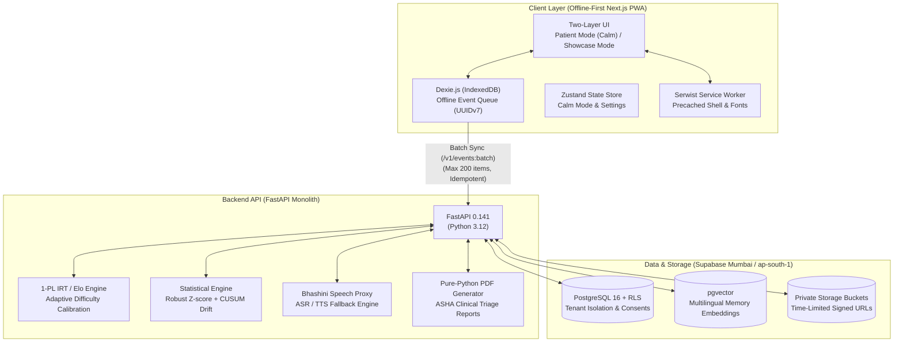

# Memora (মেমোৰা / मेमोरा)

> **AI-Powered Cognitive Stimulation, Reminiscence, and Explainable Care Triaging for the Elderly in North Eastern India**  
> Built for the **Smart India Hackathon 2026** | Problem Statement **SIH26003** (Ministry of Development of North Eastern Region — MDoNER)

[](LICENSE)
[](frontend/)
[](backend/)
[](frontend/)
[](frontend/)
[](frontend/src/locales/)
[-purple.svg)](frontend/src/lib/sync.ts)
[-teal.svg)](db/schema.sql)
[](docs/DESIGN.md)

---

## 📌 Executive Summary

**Memora** is a calm, culturally grounded, offline-first cognitive stimulation and memory-assistance platform designed for elderly individuals living with age-related memory challenges and mild-to-moderate dementia across the eight states of North Eastern India (Assam, Arunachal Pradesh, Manipur, Meghalaya, Mizoram, Nagaland, Sikkim, and Tripura).

Unlike generic cognitive tools developed for Western contexts, Memora grounds cognitive exercises in the authentic cultural memories, folklore, songs, and textiles of the North East (such as Assamese Gamosa, Bihu Dhol, tea gardens, and Brahmaputra river journeys). It features an **Item Response Theory (1-PL IRT / Elo)** adaptive engine, a robust **Median Absolute Deviation (MAD) & CUSUM drift-detection** statistical layer, and a tri-role ecosystem connecting **Patients**, **Family Caregivers**, and frontline **ASHA health workers**.

> [!IMPORTANT]
> **Strict Non-Diagnostic Commitment**: Memora is **not** a diagnostic device, clinical screening tool, or curative treatment. It does not output diagnostic labels or disease stages (such as "Alzheimer's detected" or "Stage 2"). If a patient exhibits persistent cognitive drift, Memora generates calm, explainable summaries recommending: *"Performance has dipped compared with their usual; consider consulting a healthcare professional for a routine check-up."*

---

## 📖 Table of Contents

- [The North Eastern India Context](#-the-north-eastern-india-context)
- [System Architecture](#-system-architecture)
- [Three-Role Care Ecosystem](#-three-role-care-ecosystem)
  - [1. Patient Experience (Calm Layer)](#1-patient-experience-calm-layer)
  - [2. Caregiver Portal (Family Memories)](#2-caregiver-portal-family-memories)
  - [3. ASHA Worker & Clinician Triage](#3-asha-worker--clinician-triage)
- [3D Memory House (WebGL + Fallback)](#-3d-memory-house-webgl--fallback)
- [AI & Statistical Methodology](#-ai--statistical-methodology)
- [Privacy, Ethics & DPDP Act 2023](#-privacy-ethics--dpdp-act-2023)
- [Design System & Calm Philosophy](#-design-system--calm-philosophy)
- [Supported Languages & Typography](#-supported-languages--typography)
- [Tech Stack](#-tech-stack)
- [Local Setup & Quickstart](#-local-setup--quickstart)
- [Testing & Quality Verification](#-testing--quality-verification)
- [API Contract & Endpoints](#-api-contract--endpoints)
- [Repository Structure](#-repository-structure)
- [License & Acknowledgements](#-license--acknowledgements)

---

## 🌏 The North Eastern India Context

Elderly care in the North Eastern Region (NER) faces unique systemic hurdles:
1. **Geographic Remoteness & Hill Terrain**: Frail elders often live hours away from district hospitals and specialized geriatricians.
2. **Intermittent Connectivity**: 2G/3G networks and frequent power or network cuts demand an architecture that operates **100% offline without degradation**.
3. **Linguistic Diversity**: Elderly family members often speak only regional languages or dialects (Assamese, Bodo, Meitei, Bengali, Hindi).
4. **Cultural Alienation in Cognitive Tools**: Existing apps present foreign items (e.g., baseballs, western cityscapes) that cause confusion and agitation rather than reminiscence.

**Memora solves this** by pairing local folklore, traditional music, and familiar family artifacts with local-language voice interaction, zero countdown timers, and seamless background sync when connectivity returns.

---

## 🏛 System Architecture

Memora is organized as a lightweight, robust monolith and progressive web application:



---

## 👥 Three-Role Care Ecosystem

### 1. Patient Experience (Calm Layer)
*Dedicated URL: `/[locale]/play`*

Designed specifically for elderly individuals (60+) experiencing memory difficulties:
- **Zero Stress Guarantee**: No countdown timers, no scores, no failure buzzers, and no auto-advancing carousels.
- **Large Accessibility Touch Targets**: All interactive elements are strictly **≥ 64px** in height with high-contrast text and warm borders.
- **Orientation Anchor (`DayHeader`)**: Persistent greeting stating the current day, date, and time of day to reduce disorientation.
- **Memory Match Game**: Culturally paired cards with authentic NER symbols (Assamese *Gamosa*, Assam tea leaf, and traditional *Bihu Dhol*) using gentle card flips (150–250ms).
- **Family Memory Album (`/play/album`)**: High-resolution family photos paired with a 1-tap "Listen" voice narration button.
- **Calm Companion (`/play/talk`)**: Voice-activated conversational agent grounded in family memories, featuring explicit-tap mic capture and zero voice biometrics storage.
- **Daily Routine Care (`/play/reminders`)**: Low-cognitive-load reminders for medication, hydration, and family calls.
- **Persistent Safety Bar (`FamilyCallBar`)**: Sticky bottom bar with 1-tap emergency contacts for family members and ASHA workers.

---

### 2. Caregiver Portal (Family Memories)
*Dedicated URL: `/[locale]/care`*

Empowers family members to curate memories and track longitudinal wellness:
- **Family Memories Bank**: Upload photos, oral stories, and traditional songs. Tag family members, dates, and locations.
- **AI Quiz Approval Queue (`QuizApprovalQueue`)**: AI-generated reminiscence quiz questions are strictly quarantined until explicitly reviewed and approved by the caregiver.
- **14-Day Longitudinal Wellness Chart**: Visual Recharts line chart mapping cognitive session engagement against a shaded individual baseline ("usual range").
- **"Unwell Today" Illness Suppression**: Toggle to flag acute days (fever, sleeplessness) to prevent statistical baseline contamination.
- **Family Timeline & Directory (`/care/timeline`, `/care/people`)**: Chronological visual journey of the elder's life stories and loved ones.

---

### 3. ASHA Worker & Clinician Triage
*Dedicated URL: `/[locale]/asha`*

Built for community health workers (ASHAs) and Primary Health Centre (PHC) medical officers managing 20–30 village households:
- **Automated Triage Sorting**: Patients are automatically ordered by priority:
  - 🔴 **Urgent Check-in**: Sustained 3+ day drift below personal baseline.
  - 🟡 **Watch**: Mild variance or recent acute illness report.
  - 🟢 **Steady**: Performance aligned with historical normal range.
- **Explainable Statistical Evidence**: Tap "Show the numbers" to view the exact math triggering the alert (observed score, baseline range, MAD Z-score, and cumulative CUSUM sum).
- **Pure-Python PDF Clinical Export**: 1-tap generation of an offline, printable diagnostic assistance summary for physician review.

---

## 🏛 3D Memory House (WebGL + Fallback)
*Dedicated URL: `/[locale]/house`*

An immersive, memory-grounded architectural pavilion rendered in **Three.js** and **React Three Fiber (R3F)**:
- **Cinematic Experience**: Floating dust particles, warm wireframe arches, ambient North Eastern soundscapes, framed memories, and 56px on-screen directional walk controls.
- **Intelligent Graceful Degradation**:
  The 3D canvas automatically unloads and falls back to a clean, accessible **2D Memory House Album** under any of the following conditions:
  - User has **Calm Mode** enabled.
  - User device prefers reduced motion (`prefers-reduced-motion`).
  - Device lacks WebGL hardware acceleration.
  - Rendering framerate drops below 40 FPS for more than 2 seconds.
  - Low-memory device (`navigator.deviceMemory <= 4`).
  - User is on mobile data with `Save-Data: on`.

---

## 🧠 AI & Statistical Methodology

Memora rejects black-box deep learning for clinical triaging in favor of transparent, explainable mathematics:

### 1. Adaptive Difficulty (1-PL IRT / Elo)
Patient ability ($\theta$) and activity item difficulty ($b$) are modeled using a One-Parameter Logistic Item Response Theory model:
$$P(\text{correct} \mid \theta, b) = \frac{1}{1 + e^{-(\theta - b)}}$$
- **Optimal Target Difficulty**: The engine selects items matching $\theta - \ln(3)$ to target a **75% success rate**, ensuring activities feel empowering rather than frustrating.
- **Safety Termination Rule**: If 3 consecutive incorrect choices occur, the session terminates immediately and calmly transitions to a soothing family photo or song.

### 2. Robust Drift Detection (Median / MAD & One-Sided CUSUM)
Standard deviations are vulnerable to single-day anomalies. Memora calculates a robust Z-score based on median and Median Absolute Deviation:
$$\text{MAD} = \text{median}(|x_i - \tilde{x}|), \quad Z = \frac{x - \tilde{x}}{1.4826 \times \text{MAD}}$$
- **One-Sided CUSUM Drift**: Accumulates subtle downward deviations over a 14-day rolling window:
$$S_t = \max(0, S_{t-1} + (k - Z_t))$$
- Alerts trigger only when $S_t > h$ across consecutive sessions, preventing false alarms from occasional fatigue.

### 3. Reminiscence Quiz Generation with Claude 3.5 & Guardrails
- Caregiver-uploaded photos and captions are embedded into `pgvector`.
- Anthropic Claude generates culturally sensitive reminiscence multiple-choice questions.
- Every generated question passes a safety blocklist filter and is placed into the caregiver approval queue before reaching the patient.

### 4. Multimodal Speech Proxy (Bhashini + Fallbacks)
- Primary: **Bhashini ASR/TTS** (Government of India national language translation mission).
- Fallback 1: High-fidelity web speech synthesis.
- Fallback 2: Pre-recorded audio prompts.
- **Zero Audio Storage**: Audio is streamed in-memory for ephemeral transcription and immediately discarded.

---

## 🔒 Privacy, Ethics & DPDP Act 2023

Memora complies with India's **Digital Personal Data Protection (DPDP) Act 2023**:

1. **Consent Gating**: Database Row Level Security (RLS) blocks all game event and memory insertions unless an active, verified consent row exists in `consents`.
2. **Guardian Flow for Impaired Capacity**: When an elder lacks legal capacity, a family guardian completes a structured consent declaration with relationship tracking.
3. **Data Residency**: All user profiles, activity events, and memory assets reside strictly within Indian jurisdiction (Supabase `ap-south-1`, Mumbai region).
4. **Time-Limited Media URLs**: Photos and voice stories reside in private cloud storage and are accessible solely via signed URLs expiring in 15 minutes.
5. **Right to Erasure**: Deleting a memory cascades deletion to private file storage and vector embeddings immediately.

---

## 🎨 Design System & Calm Philosophy

Memora adheres to **Amendment A1** of `DESIGN.md`:

```css
/* Core Design Tokens (tokens.css) */
--bg:          #FBF8F3;  /* Warm off-white paper */
--surface:     #FFFFFF;  /* Crisp card background */
--ink:         #1F2933;  /* Deep charcoal text (>12:1 contrast) */
--ink-soft:    #4B5563;  /* Supporting labels */
--primary:     #2F6F6B;  /* Calming Assam tea teal */
--primary-ink: #FFFFFF;  /* High-contrast button text */
--accent:      #E8A33D;  /* Warm mustard amber (highlights) */
--success:     #3E8E5A;  /* Gentle forest green */
--alert:       #B4452F;  /* Brick terracotta (caregiver alerts only) */
--focus:       #1D4ED8;  /* 3px high-visibility focus ring */
```

- **Dual-Layer Presentation**:
  - **Showcase Layer (`/`, `/care`, `/asha`)**: Warm, cinematic typography with smooth scroll and rich storytelling.
  - **Patient Layer (`/play`)**: Serene, distraction-free interface with locked layout consistency.
- **Global Calm Mode**: A single toggle in the header instantly disables all parallax, 3D, and ambient motion across the entire site.

---

## 🌐 Supported Languages & Typography

Memora supports **6 regional languages** across North East India with 100% key parity:

| Code | Language | Script | Font Family |
|---|---|---|---|
| `en` | English | Latin | Atkinson Hyperlegible |
| `hi` | हिन्दी (Hindi) | Devanagari | Noto Sans Devanagari |
| `as` | অসমীয়া (Assamese) | Bengali-Assamese | Noto Sans Bengali |
| `bn` | বাংলা (Bengali) | Bengali | Noto Sans Bengali |
| `brx`| बड़ो (Bodo) | Devanagari | Noto Sans Devanagari |
| `mni`| মৈতৈলোন্ (Meitei) | Bengali / Meetei Mayek | Noto Sans Meetei Mayek |

> [!NOTE]
> All fonts are **100% self-hosted** in `frontend/public/fonts/`. No external Google Fonts CDN is called at runtime, ensuring complete offline availability.

---

## 🛠 Tech Stack

### Frontend
- **Framework**: Next.js 16.3.7 (App Router, Turbopack, 100% SSG)
- **Runtime & UI**: React 19.3.0, TypeScript 5.8
- **Styling**: Tailwind CSS v4, Canonical Design Tokens
- **PWA & Offline**: Serwist 9.5.12, Dexie 4.4.6 (IndexedDB)
- **3D Graphics**: Three.js 0.186, React Three Fiber 9.8, Drei 10.7
- **Motion & Smooth Scroll**: Motion 14.0, Lenis 1.3
- **State Management**: Zustand 5.0 (with LocalStorage persistence)
- **Charts & Data Viz**: Recharts 3.10.1
- **Internationalization**: next-intl 4.14.8

### Backend
- **Framework**: FastAPI 0.141.1, Uvicorn 0.34.0
- **Validation**: Pydantic v2.12.0
- **HTTP Client**: HTTPX 0.28.1
- **Security**: Python-JOSE, Cryptography
- **Testing**: Pytest 8.3.4, Pytest-Asyncio

### Database & Storage
- **Database**: PostgreSQL 16 on Supabase (`ap-south-1` Mumbai)
- **Vector Search**: `pgvector` for similarity matching
- **Security**: PostgreSQL Row Level Security (RLS)

---

## 🚀 Local Setup & Quickstart

### Prerequisites
- **Node.js** >= 20.x
- **Python** >= 3.12
- **npm** or **pnpm**
- **Git**

### 1. Clone the Repository
```bash
git clone https://github.com/krishporwal011/Memora-HealthCare.git
cd Memora-HealthCare
```

### 2. Frontend Setup
```bash
cd frontend
npm install

# Start the frontend development server
npm run dev
```
The application will be live at: **`http://localhost:3000`**

### 3. Backend Setup
```bash
cd ../backend

# Create and activate Python virtual environment
python3 -m venv .venv
source .venv/bin/activate  # On Windows: .venv\Scripts\activate

# Install dependencies
pip install -r requirements.txt

# Start the FastAPI server
uvicorn app.main:app --reload --port 8000
```
API Documentation (Swagger UI) is available at: **`http://localhost:8000/docs`**

### 4. Running with Docker Compose
To run the full stack locally with a single command:
```bash
docker compose up --build
```

---

## 🧪 Testing & Quality Verification

Memora maintains a **100% green testing pipeline** across both frontend and backend suites:

```bash
# 1. Run Frontend Vitest Suite (86 tests)
cd frontend
npm test

# 2. Run TypeScript Strict Typecheck (0 errors)
npx tsc --noEmit

# 3. Test Production Static Build (99 SSG Pages)
npm run build

# 4. Run Backend Pytest Suite (52 tests)
cd ../backend
source .venv/bin/activate
pytest -q
```

### Summary of Test Suites
- **86 Vitest Tests**: Component rendering, patient 64px tap bounds, offline Dexie queue sync, IRT adaptive calibration, i18n locale completeness, and 3D memory house fallback triggers.
- **52 Pytest Tests**: FastAPI authentication, RLS multi-tenant isolation, DPDP consent gating, idempotent batch ingestion, robust MAD Z-score / CUSUM drift detection, and PDF generation.
- **Total**: **138 automated tests passing**.

---

## 📡 API Contract & Endpoints

| Method | Endpoint | Description |
|---|---|---|
| `GET` | `/v1/health` | Health check and API version status |
| `POST` | `/v1/onboarding` | Caregiver & patient registration with consent |
| `GET` | `/v1/patients` | List patients assigned to authenticated user |
| `GET` | `/v1/patients/{id}/ability` | Historical ability ($\theta$) trajectory |
| `POST` | `/v1/events:batch` | Idempotent offline event batch ingestion (max 200) |
| `GET` | `/v1/patients/{id}/memories`| List caregiver-uploaded memories |
| `POST` | `/v1/patients/{id}/memories`| Upload family photo/song/story with caption |
| `GET` | `/v1/patients/{id}/approval-queue` | AI quiz items awaiting caregiver approval |
| `POST` | `/v1/quiz-items/{id}/approve` | Approve AI quiz item for patient view |
| `POST` | `/v1/quiz-items/{id}/reject` | Reject AI quiz item |
| `GET` | `/v1/asha/patients` | ASHA patient triage summary list |
| `GET` | `/v1/asha/patients/{id}` | Detailed patient statistical drift breakdown |
| `GET` | `/v1/asha/patients/{id}/report.pdf` | Pure-Python clinical summary PDF export |
| `POST` | `/v1/speech/transcribe` | Ephemeral speech-to-text proxy |
| `POST` | `/v1/speech/synthesize` | Speech synthesis proxy |

---

## 📂 Repository Structure

```text
Memora-HealthCare/
├── README.md                 # Master project documentation
├── AGENTS.md                 # AI agent memory, instructions, and rules
├── DESIGN.md                 # UI/UX design tokens and Amendment A1 spec
├── api/
│   └── openapi.yaml          # OpenAPI 3.1 canonical contract
├── db/
│   └── schema.sql            # PostgreSQL schema + RLS policies
├── docs/
│   ├── redesign/             # Frontend redesign logs & QA report
│   └── research/             # Sourced research notes (R1-R10)
├── backend/
│   ├── app/
│   │   ├── main.py           # FastAPI app & endpoints
│   │   ├── auth.py           # Authentication dependencies
│   │   ├── database.py       # Mock database & Supabase driver
│   │   └── services/
│   │       ├── adaptive.py   # 1-PL IRT / Elo adaptive difficulty
│   │       ├── anomaly.py    # Robust Z-score & CUSUM drift detection
│   │       ├── alert_language.py # Non-diagnostic copy generator
│   │       ├── pdf_generator.py  # Pure-Python ASHA PDF export
│   │       ├── quiz_generator.py # Claude 3.5 RAG quiz generator
│   │       └── speech.py     # Bhashini ASR/TTS proxy
│   └── tests/                # 52 backend pytest suites
└── frontend/
    ├── public/
    │   ├── fonts/            # Self-hosted Noto & Atkinson fonts
    │   └── memora-assets/    # Authentic NER cultural images & avatars
    └── src/
        ├── app/[locale]/     # Next.js App Router (6 locales)
        │   ├── (patient)/    # Calm patient routes (/play, /album, /talk)
        │   ├── (caregiver)/  # Caregiver portal (/care, /timeline, /people)
        │   ├── (asha)/       # ASHA triage portal (/asha)
        │   ├── house/        # 3D Memory House & Album fallback
        │   ├── sync/         # Offline sync & Dexie health center
        │   └── settings/     # User preferences & Calm mode toggle
        ├── components/
        │   ├── patient/      # High-contrast, large-target components
        │   └── ui/           # Token-based shared UI components
        ├── lib/
        │   ├── adaptive.ts   # Client difficulty offset math
        │   ├── sync.ts       # Dexie offline sync engine
        │   └── store/        # Zustand application store
        └── locales/          # Localization strings (as, bn, brx, en, hi, mni)
```

---

## ⚖️ License & Acknowledgements

This project is licensed under the **MIT License** — see the [LICENSE](LICENSE) file for details.

### Acknowledgements
- **Smart India Hackathon 2026**: Problem statement **SIH26003**.
- **Ministry of Development of North Eastern Region (MDoNER)**: For prioritizing elderly care and cognitive health in remote regional populations.
- **Digital India Bhashini Mission**: For foundational language technologies enabling local speech equity.
- **Atkinson Hyperlegible Font**: Developed by the Braille Institute for low-vision accessibility.
